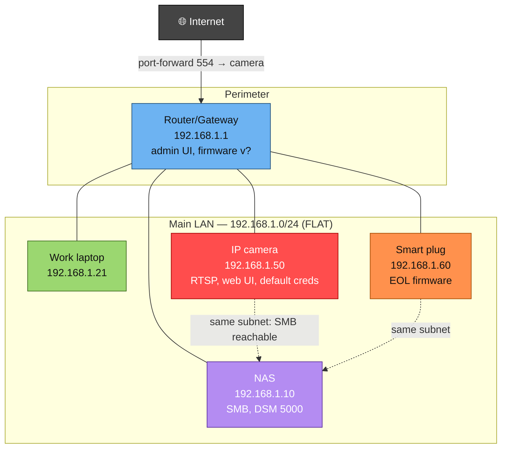
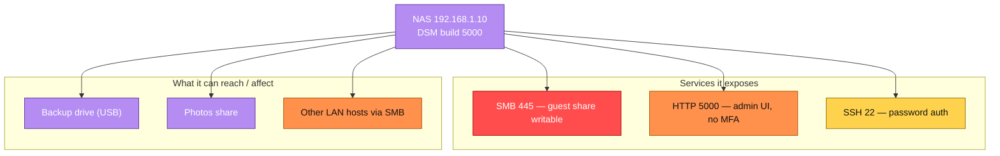

# Phase 5 — Visualize: pivotable mermaid topology & attack-path graphs

**Goal:** turn the inventory and findings into graphs the user can *read and navigate* —
the Maltego/Zenmap experience of seeing the network and tracing paths through it. Mermaid
renders in most markdown viewers, GitHub, and many editors, so these drop straight into
the report.

Build three views, in increasing focus. Always produce the first two; add the third for
any host that warrants a close-up.

A consistent **risk color legend** across all graphs lets the eye jump to trouble:

```
classDef crit    fill:#ff4d4d,stroke:#a30000,color:#fff;   %% critical risk
classDef high    fill:#ff914d,stroke:#a34b00,color:#111;   %% high risk
classDef med      fill:#ffd24d,stroke:#8a6d00,color:#111;   %% medium risk
classDef low      fill:#9bd770,stroke:#3d6b1f,color:#111;   %% low risk / hardened
classDef infra    fill:#6db3f2,stroke:#1f4e79,color:#111;   %% network infrastructure
classDef crown    fill:#b48cf2,stroke:#5a2ca0,color:#fff;   %% crown jewels
classDef internet fill:#444,stroke:#000,color:#fff;         %% the outside world
```

## View 1 — Topology map (the Zenmap-style layout)

Group devices into trust zones using subgraphs, draw the links that carry traffic/trust,
and color every node by its Phase 4 risk. The zones themselves tell the segmentation
story: a single zone holding everything is the visual of a flat network.



Conventions that make it readable:
- **Solid edges** = physical/normal connectivity; **dotted edges** = latent attack
  reachability (a path that exists because of poor segmentation). Dotted lines pointing at
  a purple crown-jewel node are exactly what the user should see and dislike.
- Put the exposed port/service and the headline weakness right in the node label, so the
  graph is self-documenting.
- One subgraph per trust zone. If there's only one subgraph, that's the finding.

## View 2 — Attack-path graph (the Maltego-style pivot chain)

This is the money shot: trace the Phase 3 narratives as directed paths from entry point to
crown jewel, labeling each edge with the weakness that enables the hop. Keep it to the few
most plausible paths so it stays legible.

```mermaid
graph LR
    A["🌐 Attacker<br/>(internet)"]:::internet
    B["IP camera<br/>default creds + port-forward"]:::crit
    C["Foothold on<br/>flat main LAN"]:::high
    D["NAS<br/>guest-writable SMB share"]:::crit
    E["Backup drive<br/>attached to NAS"]:::crown

    A -->|"1 · exposed 554/web, default login"| B
    B -->|"2 · no segmentation, SMB 445 open"| C
    C -->|"3 · anonymous share write"| D
    D -->|"4 · backup online & reachable"| E

    classDef crit fill:#ff4d4d,stroke:#a30000,color:#fff;
    classDef high fill:#ff914d,stroke:#a34b00,color:#111;
    classDef crown fill:#b48cf2,stroke:#5a2ca0,color:#fff;
    classDef internet fill:#444,stroke:#000,color:#fff;
```



Each numbered edge is both the attack step *and* a remediation hook — "break any link in
this chain and the path dies." In the report, list the fix beside each step (close the
port-forward; segment the camera; fix share perms; take the backup offline) so the user
can see that fixing step 2 or step 4 alone defuses the whole path.

## View 3 — Per-node pivot view (zoom into one host)

For a high-value or high-risk host, a focused graph showing everything *it* exposes and
everything *it* can reach — the "double-click a node in Maltego" experience. Useful for the
NAS, the router, or any device that turned out to be a hub of trust.



## Navigation / pivoting

Mermaid supports `click` directives, which many renderers turn into working links — use
them to connect a node to its detailed finding so the graph becomes a table of contents:

```
click NAS "#finding-nas-smb" "Jump to NAS findings"
```

If a renderer doesn't support clicks, keep node IDs stable and matching the finding
anchors/headings in the report, so a reader can still pivot by searching the ID. When the
network is large, don't cram everything into one graph — produce one topology overview
plus a handful of per-zone or per-path graphs, and link between them. Legibility beats
completeness; a graph nobody can read points nowhere.

## Keeping graphs in sync with the data

Generate these from the asset inventory and ranked findings, not by hand from memory — the
colors must match the Phase 4 risk ratings and the edges must match the Phase 3 paths. If
the inventory is large, it's reasonable to write a small script that reads the asset table
and emits the mermaid `graph` block, so re-running the audit regenerates consistent
visuals.
